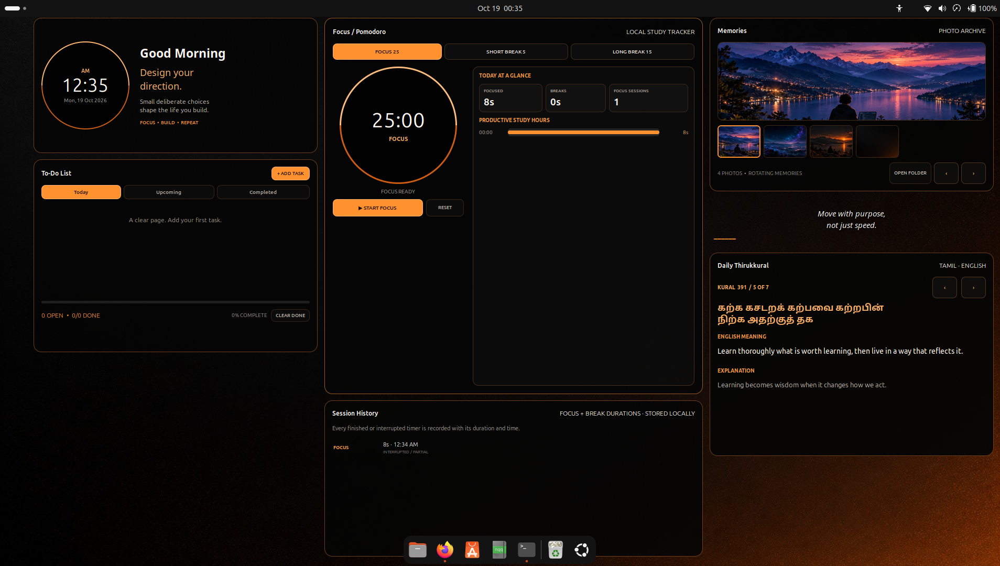

# ORBIT Productivity Desktop 🟠

**A Minimalist Ubuntu GNOME Productivity Desktop — Built for Focus, Study, and Daily Progress.**

ORBIT is a desktop productivity project designed for Ubuntu GNOME. It combines a clean black-and-orange interface with a Pomodoro timer, study-session tracking, a task manager, personal photo memories, and a daily Thirukkural.

The goal is simple: create a focused desktop environment that helps you organize tasks, track productive study time, and build consistent habits.

---

## 🖥️ Interface Preview



---

## ✨ Features

### 🕒 Clock and Daily Greeting
- Live clock and date.
- Greeting and motivational text.
- Minimal black-and-orange appearance.

### ✅ To-Do List
- Manage daily tasks.
- Organize tasks into Today, Upcoming, and Completed views.
- Set task priorities.
- Select task deadlines using a calendar.
- Track completed tasks and overall progress.

### 🍅 Pomodoro Focus Timer
- **Focus:** 25 minutes.
- **Short Break:** 5 minutes.
- **Long Break:** 15 minutes.
- Start, pause, and reset timer sessions.
- Track focus time and break durations.

### 📊 Study Productivity Tracker
- Record focus and break sessions locally.
- View daily focused time and break time.
- Count completed or interrupted sessions.
- Review recent study-session history.
- View productive study hours grouped by session start time.

### 🖼️ Personal Photo Memories
- Display personal photos on the desktop.
- Navigate through your photo collection.
- Keep photos stored locally on your computer.

Photo directory:

`~/Pictures/ORBIT-Memories/`

### 📜 Daily Thirukkural
- Tamil couplet.
- English meaning.
- Explanation and reflection.
- Navigation between entries.

### 🎨 Minimal Black-and-Orange Design
- Matte-black background.
- Warm orange highlights and borders.
- Clean typography and simple controls.
- Optional matching wallpaper.

---

## 🛠️ Technology

- JavaScript
- GNOME Shell Extensions
- GNOME Shell UI toolkit
- CSS
- Bash
- JSON
- Git and GitHub

---

## 💻 Requirements

- Ubuntu with GNOME Shell 50.x.
- GNOME user extensions enabled.
- Bash and Python 3 for the provided scripts.
- Git for version control and GitHub publishing.

ORBIT was developed for Ubuntu GNOME 50.1. Compatibility and appearance may differ on other GNOME versions.

---

## 🚀 Installation

### 1. Download the project

Clone this repository:

```bash
git clone https://github.com/praxhub/orbit-productivity-desktop.git
```

Enter the project directory:

```bash
cd orbit-productivity-desktop
```

### 2. Install ORBIT

Run:

```bash
bash ./INSTALL-ORBIT-STUDY-FOCUS.sh
```

Follow the installer instructions.

### 3. Check the extension

Run:

```bash
gnome-extensions show orbit-desktop-layer@local
```

The extension should report that it is enabled and active.

If the extension does not activate immediately, save your work, log out of Ubuntu, and log back in.

### 4. Apply the optional wallpaper

```bash
bash ./USE-ORBIT-MINIMAL-BLACK-WALLPAPER.sh
```

The wallpaper is optional; ORBIT's interface can be used with your preferred desktop background.

---

## 📁 Project Structure

```text
orbit-productivity-desktop/
│
├── extension.js
├── stylesheet.css
├── metadata.json
├── README.md
├── .gitignore
├── VALIDATION.txt
├── GITHUB_UPLOAD_GUIDE.md
│
├── INSTALL-ORBIT-STUDY-FOCUS.sh
├── RESTORE-ORBIT-STUDY-FOCUS.sh
├── USE-ORBIT-MINIMAL-BLACK-WALLPAPER.sh
├── RESTORE-ORBIT-MINIMAL-BLACK-WALLPAPER.sh
│
├── ORBIT-Minimal-Black-Wallpaper.jpg
└── ORBIT-Interface.png
```

`ORBIT-Interface.png` is the screenshot displayed in the Interface Preview section above. Upload it to the repository root for the image to appear in the README.

---

## 🔒 Local Data and Privacy

ORBIT is designed around local storage.

Tasks, study-session history, and personal photos are intended to remain on the user's computer rather than being uploaded automatically.

Typical local locations include:

- Personal photos: `~/Pictures/ORBIT-Memories/`
- Task data: `~/.local/share/orbit-desktop-layer/tasks.json`
- Study-session history: `~/.local/share/orbit-desktop-layer/study-sessions.json`

Do not commit personal photos, private task records, study histories, passwords, access tokens, or other sensitive information to GitHub.

---

## ♻️ Restore or Uninstall

To restore the previous extension files:

```bash
bash ./RESTORE-ORBIT-STUDY-FOCUS.sh
```

To restore the previous wallpaper settings:

```bash
bash ./RESTORE-ORBIT-MINIMAL-BLACK-WALLPAPER.sh
```

Review the scripts before running them, and back up important data before making system changes.

---

## 🧪 Validation

The project includes a `VALIDATION.txt` file documenting the checks performed during development.

Actual desktop rendering and interaction should be verified on the target Ubuntu GNOME system.

---

## 🎯 Project Goal

ORBIT aims to make the desktop more than a place to open applications. It is designed to make daily planning, focused study, progress tracking, and reflection part of the desktop experience.

**Plan your work. Focus deeply. Track your progress. Improve every day.**

---

## 👨‍💻 Repository

**GitHub:** [praxhub/orbit-productivity-desktop](https://github.com/praxhub/orbit-productivity-desktop)

Contributions, suggestions, and feedback are welcome.

---

*ORBIT Productivity Desktop — Focus. Build. Repeat.*

---

## License

ORBIT Productivity Desktop is licensed under the MIT License. See the [LICENSE](LICENSE) file for details.
